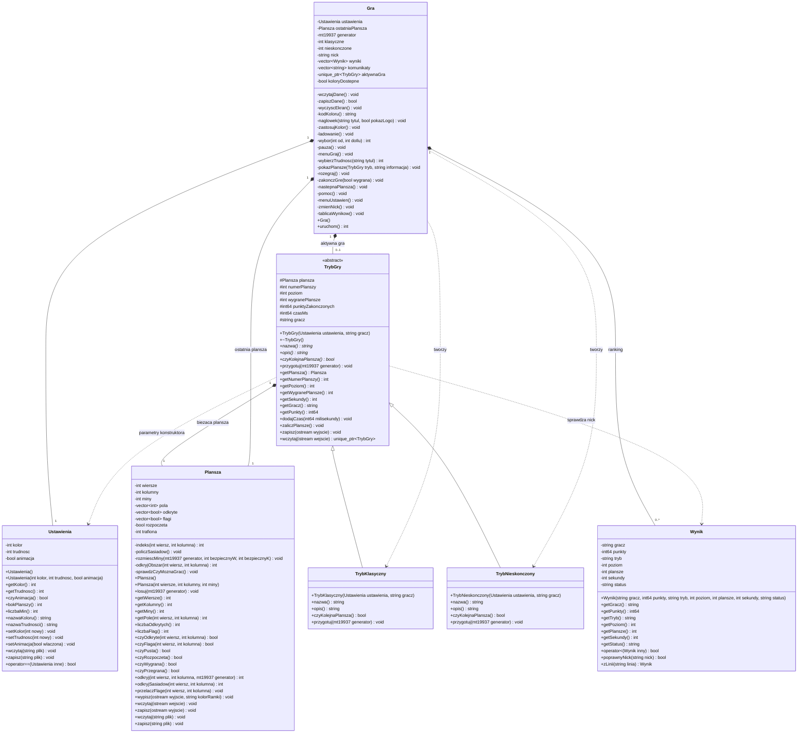

# Schemat klas

Diagram mozna wyswietlic na GitHubie (Mermaid). `+` oznacza public,
`-` private, `#` protected. Dla czytelnosci pominieto std:: oraz const
i referencje w sygnaturach. Typ int64 oznacza long long.

Metody nazwa, opis i czyKolejnaPlansza sa czysto wirtualne w bazie.
Przygotuj i destruktor sa wirtualne. Oba tryby przeslaniaja metody przez override.
W praktyce Gra wywoluje metody obiektu przechowywanego jako unique_ptr do bazy,
a czyKolejnaPlansza rozstrzyga o zakonczeniu klasycznego lub dalszej serii.

GetPlansza wystepuje w dwoch wersjach: const do odczytu i modyfikujacej do ruchow.
TrybGry::wczytaj jest metoda statyczna tworzaca odpowiednia klase pochodna.
Wynik::poprawnyNick i Wynik::zLinii takze sa statyczne.
Operator< okresla kolejnosc wynikow.

Zaprzyjaznione operator<<(ostream&, const Plansza&) i
operator<<(ostream&, const Wynik&) sa funkcjami zewnetrznymi. Pierwszy rysuje
plansze bez kolorow, drugi formatuje rekord do pliku. Operator== ustawien
wykrywa zmiane preferencji, a operator< wyniku ustawia najlepsze rekordy
na poczatku podczas sortowania.

Kompozycja oznacza wlasne pola obiektu, wektor rekordow lub obiekt posiadany
przez unique_ptr. Przerwana zaleznosc oznacza utworzenie obiektu lub uzycie
jego interfejsu. Nie wystepuje trwala agregacja zewnetrznych obiektow.
Dokladne sygnatury i dostep do metod znajduja sie w plikach include/*.h.
