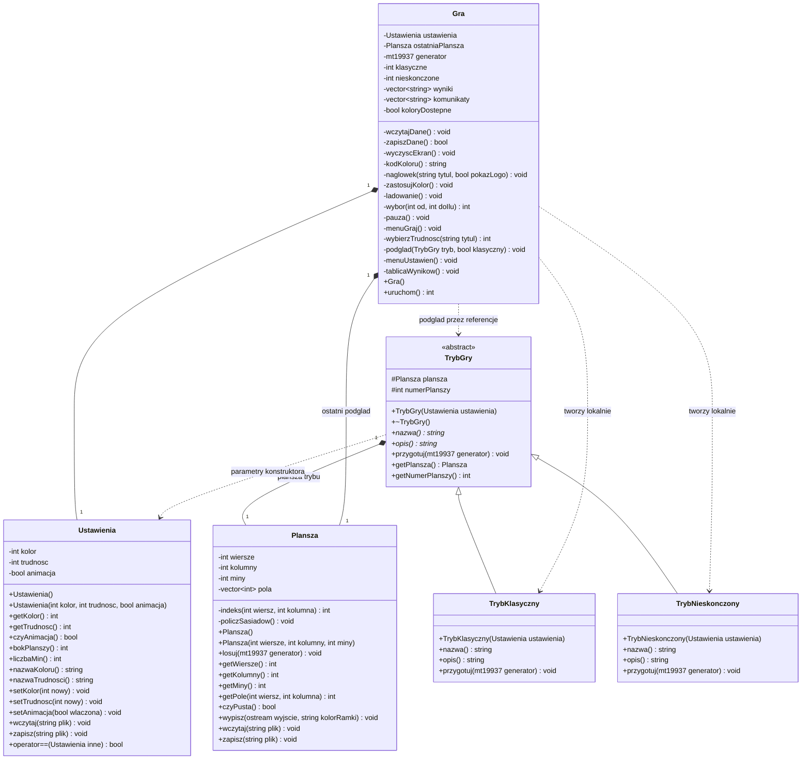

# Schemat klas

Diagram mozna wyswietlic na GitHubie (Mermaid). `+` oznacza public,
`-` private, `#` protected. Wspolne metody wirtualne zaznaczono w opisach.

`nazwa` i `opis` sa czysto wirtualne w bazie; `przygotuj` i destruktor sa
wirtualne. Klasy pochodne przeslaniaja `nazwa`, `opis` oraz `przygotuj`.
W diagramie pominieto `const` i referencje w sygnaturach dla czytelnosci;
dokladne deklaracje znajduja sie w naglowkach.

Zaprzyjazniona funkcja `operator<<(ostream&, const Plansza&)` jest funkcja
zewnetrzna, a nie metoda klasy. Korzysta z danych planszy przy jej wypisywaniu.
`Ustawienia::operator==` jest metoda klasy i pozwala wykryc zmiane ustawien.

Kompozycja oznacza wlasne pola obiektu. Zaleznosc przerywana oznacza uzycie
parametru albo utworzenie obiektu lokalnego. Nie ma trwalej agregacji obiektow
zewnetrznych, dlatego nie dodano pustego rombu.
